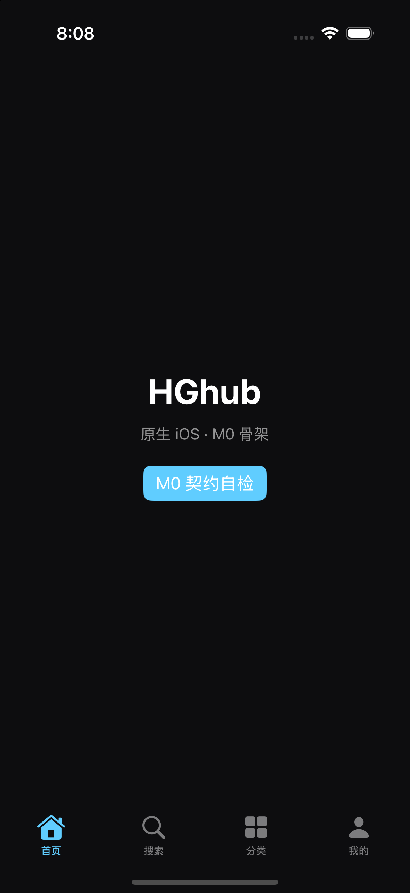

# 开发计划 · ios-native

> 版本：v0.1（M0 执行中）
> 更新：2026-11-17
> 关联：[需求](requirements.md) · [架构](architecture.md) · [接口契约](api-contract.md) · [ADR](decisions.md)

---

## 1. 执行原则

1. **文档先行**：需求/架构/契约变了，先改文档，再改代码。
2. **里程碑门禁**：上一 milestone 的验收项没全过，不进入下一个；允许并行做“无依赖”的任务（如设计 token）。
3. **每个任务可验收**：不以“代码写完”为完成，以“行为可验证”为完成。
4. **小步提交**：一个任务一个 commit（或一组紧密相关 commit），message 用 `feat(ios): ...` / `fix(ios): ...` / `docs(ios): ...`。
5. **不扩大范围**：需求外的东西记到“待评估”，不顺手做。
6. **不破坏现有端**：任何改动不得影响根目录 Tauri 构建。

## 2. 里程碑总览

| 阶段 | 目标 | 交付物 | 预估 | 状态 |
|---|---|---|---|---|
| **M0** | 工程骨架 + 契约验证 | 可编译 App、XcodeGen、APIClient、模型、自检页、fixtures 计划 | 2–3 人日 | **进行中** |
| **M1** | 应用外壳 + 基础设施 | 设计 token、Tab、导航、Session、LocalLibrary、LineStore、错误/toast | 3–4 人日 | 待开始 |
| **M2** | 首页 + 播放器 | 竖滑 Feed、单 AVPlayer、封面、续播、手势、选集/评论入口 | 6–8 人日 | 待开始 |
| **M3** | 详情 + 互动 | 详情、选集、评论、点赞/收藏/关注、登录拦截 | 5–7 人日 | 待开始 |
| **M4** | 搜索 + 分类 + 榜单 | 搜索历史、频道、三榜单 | 3–4 人日 | 待开始 |
| **M5** | 我的 + 设置 + 线路 | 资料卡、收藏/历史、设置、线路选择/探测、缓存/更新 | 4–5 人日 | 待开始 |
| **M6** | 吃瓜 Posts | 列表、详情、HTML 渲染、图片、互动 | 3–4 人日 | 待开始 |
| **M7** | 打磨 + 发布 | PiP/AirPlay/后台、性能、无障碍、图标、签名/安装 | 4–6 人日 | 待开始 |

> 合计约 30–40 人日；依赖选型省掉图片/HTML/Keychain/持久化轮子后，实际约 25–35 人日。MVP = M0–M3，约 2–3 周（熟手全职）。

## 3. M0：工程骨架 + 契约验证（完成）

**目标**：证明“工程能生成、依赖能解析、空 App 能跑、核心接口能调通”，不写业务 UI。

| ID | 任务 | 交付 | 验收 | 状态 |
|---|---|---|---|---|
| M0-01 | 写六份文档 | `README` + `docs/*` | 文档齐全、互相链接 | ✅ 完成 |
| M0-02 | 工程骨架 | `project.yml`、`.gitignore`、Assets、目录 | `xcodegen generate` 成功 | ✅ 完成 |
| M0-03 | App 外壳 | `HGHubApp`、`AppState`、`RootTabView`、4 个占位 Tab | 模拟器启动见 4 Tab | ✅ 完成 |
| M0-04 | 网络层 | `APIClient`、`EdgeEnvelope`、`APIError`、重试 | 信封编码/模型解码单测通过；401 待集成 | ✅ 完成 |
| M0-05 | 模型 | `Paged<T>`、`VideoCard`、`PlayInfo`、`User`/`Session` | fixtures 解码通过 | ✅ 完成 |
| M0-06 | 契约自检页 | Debug 页：boot/feed/playback/封面 | 页面可用；Feed/Playback 真实请求已验证 | ✅ 完成 |
| M0-07 | 封面解密 | `CoverImageDecoder` + Nuke pipeline | 解码器 + 单测通过；真实封面下载 + AES 解密得到 JPEG | ✅ 完成 |
| M0-08 | 构建验证 | 模拟器 `xcodebuild build` + 启动 | 构建通过、App 启动 | ✅ 完成 |
| M0-09 | 状态回写 | 本文件 + README 状态 | 状态与代码一致 | ✅ 完成 |

**M0 完成定义**：M0-01 ~ M0-09 全部 ✅；依赖版本由 `project.yml` 的 `exactVersion` 锁定（`Package.resolved` 随 `.xcodeproj` 生成、不入库）；无未登记 TODO。

**M0 验证记录（2026-11-17）**：

- `xcodegen generate`：通过（XcodeGen 2.x + Xcode 27.1）。
- SPM 解析：10 个包全部锁定到预期版本。
- `xcodebuild build`（generic iOS Simulator）：`BUILD SUCCEEDED`。
- `xcodebuild test`（iPhone 17 Pro / iOS 26.2）：**7 个单元测试 / 4 suites + 3 个 UI 测试**，`TEST SUCCEEDED`。
- 安装启动：iPhone 16 Pro（iOS 18.5）模拟器，4 Tab + M0 自检入口正常；UI 测试确认点击可打开自检页。
- 真实网络（macOS 系统代理 `127.0.0.1:7890`）：Feed `HTTP 200`（10 条 / 179 页 / 1781 总条数）、Playback `HTTP 200`（`streams.main` 有地址）、封面下载 + AES-128-CBC 解密得到 `1086x1448 JPEG`。
- fixtures：`HGHubTests/Fixtures/feed_page1.json`（真实 Feed，已脱敏）、`playback_117_3.json`（真实 Playback，已脱敏）。



## 4. M1：应用外壳 + 基础设施

| ID | 任务 | 验收 |
|---|---|---|
| M1-01 | DesignSystem：颜色/字体/间距/按钮/Chip/Avatar/空态/骨架 | 深/浅色预览一致 |
| M1-02 | `RootTabView` + 每 Tab `NavigationStack` + `Route` | 切 Tab 保留栈；push/pop 正常 |
| M1-03 | `SessionStore`（Valet）+ 启动恢复 | 存/读/清 token；重启保持 |
| M1-04 | `LocalLibrary`（Defaults） | 收藏/历史/搜索历史读写；历史 80 条上限 |
| M1-05 | `LineStore`（固定 + 持久化） | 切换重启沿用 |
| M1-06 | `ToastCenter` + 全局错误文案 | 401/网络/业务错误展示 |
| M1-07 | `AppDependencies` 组合根 + Environment 注入 | 可替换 fake |
| M1-08 | 登录 sheet 空壳 | 打开/关闭；未登录拦截可触发 |

## 5. M2：首页 + 播放器

| ID | 任务 | 验收 |
|---|---|---|
| M2-01 | `HomeViewModel` 分页 | 首屏/加载更多/去重/错误重试 |
| M2-02 | `FeedPager`（UICollectionView） | 竖滑分页跟手；预加载下一条 |
| M2-03 | `PlayerCoordinator` + `PlayerSurface` | 单 AVPlayer；切条续播；错误可见 |
| M2-04 | `PlayerOverlay` | 播放/暂停/进度/时间/倍速/静音/全屏 |
| M2-05 | 手势仲裁 | 单击/双击/上下滑/横滑/长按不冲突 |
| M2-06 | 封面 + Nuke 解密 | 列表/详情封面正常 |
| M2-07 | 选集/评论 sheet 入口 | 打开/关闭；切集生效 |
| M2-08 | 续播 | 历史进入按集/秒恢复 |

**M2 完成定义**：连续刷 30 条不崩；切条 ≤500ms 出画面；音频不重叠；播放错误有文案。

## 6. M3：详情 + 互动

| ID | 任务 | 验收 |
|---|---|---|
| M3-01 | `Detail` 模型 + 详情面板 | 标题/简介/标签/集数/作者/计数 |
| M3-02 | 点赞/收藏/关注 | 乐观更新 + 失败回滚 |
| M3-03 | 评论列表 + 发送 | 分页/去重/键盘不遮挡 |
| M3-04 | 登录拦截与 401 处理 | 只弹一次；登录后重试 |
| M3-05 | 分享（系统面板） | 标题 + 链接 |

## 7. M4：搜索 + 分类 + 榜单

| ID | 任务 | 验收 |
|---|---|---|
| M4-01 | 搜索页 + 历史 | 空词不请求；历史 12 条 |
| M4-02 | 分类频道（24/25/26/27） | 空频道隐藏；分页 |
| M4-03 | 榜单三分类 | 前 20 条；切换 |
| M4-04 | 列表 → 播放上下文 | ids/index 传入 Feed |

## 8. M5：我的 + 设置 + 线路

| ID | 任务 | 验收 |
|---|---|---|
| M5-01 | 资料卡（登录/未登录） | 退出登录 |
| M5-02 | 收藏 / 历史列表 | 进度展示；点击续播 |
| M5-03 | 设置页（主题/数据/缓存/诊断/更新/关于） | 全部可用 |
| M5-04 | 线路选择 + 镜像 + 探测 | 切换生效并持久化 |
| M5-05 | 网络诊断 | 展示并可复制 |

## 9. M6：吃瓜 Posts

| ID | 任务 | 验收 |
|---|---|---|
| M6-01 | 列表分页 | 与 Feed 一致 |
| M6-02 | 正文清洗（SwiftSoup） | 去脚本、补全 URL |
| M6-03 | 正文渲染（ZMarkupParser） | 段落/图片/链接正常 |
| M6-04 | 帖子互动 | 赞/藏/评论 |

## 10. M7：打磨 + 发布

| ID | 任务 | 验收 |
|---|---|---|
| M7-01 | PiP / AirPlay / 锁屏 / 后台音频 | 真机可用 |
| M7-02 | 性能：内存/滚动/启动 | 达标见 NFR |
| M7-03 | 无障碍 + 动态字体 | VoiceOver 抽查 |
| M7-04 | 图标 / 启动屏 / 版本号 | 图标正确 |
| M7-05 | 真机签名 + 安装 | 自用设备可安装 |
| M7-06 | 回归清单 + 文档收尾 | 全部 ✅ |

## 11. 依赖关系与关键路径

```
M0 ──▶ M1 ──▶ M2 ──▶ M3 ──▶ M5 ──▶ M7
                 │        │
                 ├──▶ M4 ─┘
                 └──▶ M6 ──┘
```

- M2 是核心路径：pager + 播放器 + 手势，风险最高；M4/M6 可以在 M2 之后并行。
- M5 依赖 M1 的 Session/LocalLibrary/LineStore。
- M7 依赖全部功能；播放器系统能力可在 M2 后提前做，但验收放 M7。

## 12. 质量门禁

每个 milestone 收尾必须跑：

```bash
cd ios-native
xcodegen generate
xcodebuild -project HGHub.xcodeproj -scheme HGHub \
  -destination 'generic/platform=iOS Simulator' build
# 测试需要具体模拟器；换成你本机 `xcrun simctl list devices available` 里的名字
xcodebuild -project HGHub.xcodeproj -scheme HGHub \
  -destination 'platform=iOS Simulator,name=iPhone 17 Pro' test
```

- SwiftFormat / SwiftLint（M1 接入）无 error。
- 新增逻辑有单测或手动验收记录。
- 文档状态与代码一致。
- 不新增未登记的 TODO/FIXME。

## 13. 风险登记

| ID | 风险 | 概率 | 影响 | 缓解 |
|---|---|---|---|---|
| R-01 | 上游域名被 DNS 污染/不可达 | 高 | 无法联调 | `URLSession` 走系统代理；模拟器复用 macOS 代理（已验证 7890）；真机配 Wi-Fi 代理；`curl` 不读系统代理，排查时加 `-x` |
| R-02 | CDN 校验 UA/Referer，AVPlayer 拉流失败 | 中 | 播放黑屏 | `AVAssetResourceLoaderDelegate` 注入 header；先直连验证 |
| R-03 | 手势与 pager 冲突 | 高 | 体验差 | 明确仲裁规则（架构 7.5）；真机调阈值 |
| R-04 | 上游 JSON 字段漂移 | 中 | 解码崩/空 | 宽松解码 + fixtures + 错误态 |
| R-05 | 多播放器/预加载导致内存高 | 中 | 卡顿/OOM | 单 AVPlayer；只预加载 1 条；Instruments |
| R-06 | 三方库与 Swift 6 编译不兼容 | 中 | 构建失败 | 版本锁定；必要时降 Swift 语言模式到 5 |
| R-07 | 免费签名 7 天过期 | 高 | 需重装 | 文档写明；自用可接受 |
| R-08 | ZMarkupParser 与 SnapshotTesting 版本冲突 | 中 | 测试依赖冲突 | 不引 SnapshotTesting；要用则锁 1.12.0 |
| R-09 | CryptoSwift 许可需致谢 | 低 | 合规 | `ACKNOWLEDGEMENTS.md` |
| R-10 | 改动误伤现有 Tauri 端 | 低 | 四端构建坏 | 只动 `ios-native/`；根目录构建回归 |

## 14. 进度记录

| 日期 | 阶段 | 记录 |
|---|---|---|
| 2026-11-17 | 规划 | 确定路线 A、iOS 17、并行目录、依赖清单、架构 |
| 2026-11-17 | M0 | 六份文档完成；XcodeGen/SPM 解析通过；APIClient + 模型 + 封面解码器落地；7 个单测 + 3 个 UI 测试通过；Feed/Playback/封面真实联调通过（系统代理） |

## 15. 下一步

**当前指针：M1-01 设计系统 / M1-02 导航与 Tab 补齐。**

具体动作：
1. 把 `DesignSystem` 从占位 Color 扩成颜色/字体/间距/按钮/Chip/Avatar/空态/骨架。
2. 补齐 `Route` 与各 Tab 的 `navigationDestination`（频道/榜单/设置/吃瓜/帖子）。
3. 接 `SessionStore` 到 `AppState`，启动恢复登录态。
4. 接 `LocalLibrary`（Defaults）与 `LineStore`，为 M2 做准备。

> 每完成一个任务，把本表对应状态改成 ✅，并在第 14 节加一行；不要等整个 milestone 结束再补。
